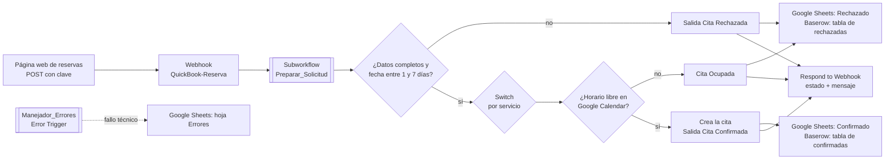

# QuickBook – Reservas automatizadas con n8n
 
QuickBook recibe solicitudes de reserva de citas (consulta médica, peluquería o consulta veterinaria) desde una página web, valida los datos y la fecha, consulta la disponibilidad en Google Calendar y responde si la reserva fue **confirmada** o **rechazada**. Cada resultado queda registrado en Google Sheets y Baserow, y los fallos técnicos se registran en una hoja aparte.
 
**Problema que resuelve:** atender reservas a mano obliga a revisar el calendario, comprobar que vengan todos los datos y responder una por una. QuickBook hace esas comprobaciones de forma automática y responde con un mensaje claro. *(Beneficios esperados; no se midieron ahorros de tiempo.)*
 
**Integrantes:** Lorena, Cesar, Juan Diego y Rossibel.
**Curso:** Automatización inteligente de procesos con n8n – EAM – 2026 II · **Entrega:** segundo corte (2026-10-26)
 
---
 
## Alcance actual
 
**Implementado**
 
- Webhook `POST` en la ruta `QuickBook-Reserva`, protegido con Header Auth y con CORS limitado al origen de la página local (`http://127.0.0.1:5500`).
- Subworkflow `Preparar_Solicitud`, que normaliza los ocho campos de la solicitud.
- Validación en el flujo principal: seis datos obligatorios (nombre, whatsapp, correo, fecha, hora y servicio) y una fecha posterior a hoy y hasta 7 días hacia adelante.
- Consulta de disponibilidad y creación del evento en Google Calendar.
- Registro en Google Sheets (hojas `Confirmado` y `Rechazado`) y en Baserow mediante HTTP Request.
- Respuesta JSON `{ "estado": ..., "mensaje": ... }` a quien envía la solicitud.
- Manejador de errores `Manejador_Errores`, asociado al flujo principal, que registra los fallos técnicos en la hoja `Errores`.
**No activo o limitado en esta versión**
 
- **Aviso por Telegram:** el nodo existe pero está **desactivado**, y su texto lee datos de un nodo también desactivado. No cuenta como funcionalidad implementada.
- **Formulario de n8n (Form Trigger):** está desactivado. La entrada real es el Webhook, usado por la página web del equipo.
- **Momento de la respuesta:** el Webhook responde en paralelo con el guardado en Sheets y Baserow. La respuesta no garantiza que el registro ya se haya completado.
- **Reintentos y duplicados:** no hay reintentos automáticos configurados. La hoja `Rechazado` actualiza por nombre (una segunda solicitud con el mismo nombre sobrescribe la anterior), mientras que `Confirmado` y Baserow agregan una fila nueva en cada ejecución. La estrategia de recuperación sin duplicados es una **propuesta**, no está implementada.
- **Switch por servicio:** clasifica la solicitud, pero sus tres salidas llevan al mismo paso (consulta de calendario).
- **Alcance de ejecución:** solución local; no hay servidor público ni túnel.
---
 
## Arquitectura
 

 
| Workflow | Archivo | Responsabilidad | Recibe / devuelve |
|---|---|---|---|
| Principal | [`workflows/Principal_QuickBook.json`](workflows/Principal_QuickBook.json) | Recibe la solicitud por Webhook, valida, consulta el calendario, registra y responde | Recibe un POST con JSON; responde `{estado, mensaje}` |
| Preparar_Solicitud | [`workflows/Preparar_Solicitud.json`](workflows/Preparar_Solicitud.json) | Normaliza los datos de entrada | Recibe `nombre`, `whatsapp`, `correo`, `fecha_preferida`, `hora_preferida`, `servicio`, `usuario_whatsapp`, `origen`; devuelve los mismos ocho campos en texto limpio (espacios sobrantes quitados y minúsculas) |
| Manejador_Errores | [`workflows/Manejador_Errores.json`](workflows/Manejador_Errores.json) | Registra los fallos técnicos del flujo principal | Recibe el evento del Error Trigger; escribe en la hoja `Errores`: `fecha_registro`, `workflow`, `nodo_error`, `mensaje_error`, `url_error`, `id_ejecucion` |
 
---
 
## Requisitos
 
- **n8n:** versión reciente. Los JSON usan, por ejemplo, Form Trigger 2.6, Edit Fields 3.5 y HTTP Request 4.5. *Versión exacta utilizada: completar.*
- **Cuentas y servicios:** Google (Calendar y Sheets), Baserow.
- **Permisos:** edición sobre el calendario y la hoja de cálculo; un token de base de datos de Baserow con permiso de escritura en las dos tablas.
---
 
## Configuración (con cuentas propias)
 
**1. Google Sheets.** Crea un libro con tres hojas:
 
| Hoja | Columnas |
|---|---|
| `Confirmado` | `nombre`, `whatsapp`, `correo`, `fecha_preferida`, `hora_preferida`, `servicio`, `estado`, `asunto`, `cuerpo` |
| `Rechazado` | las mismas columnas que `Confirmado` |
| `Errores` | `fecha_registro`, `workflow`, `nodo_error`, `mensaje_error`, `url_error`, `id_ejecucion` |
 
**2. Google Calendar.** Crea un calendario para las citas.
 
**3. Baserow.** Crea dos tablas (confirmadas y rechazadas) con estos campos de texto: `Nombre`, `Whatsapp`, `Correo`, `Fecha_preferida`, `Hora_preferida`, `Servicio`, `asunto`, `Cuerpo`, `Estado`. Anota el ID de cada tabla (aparece en la URL de la tabla).
 
**4. Credenciales en n8n** (los valores no se incluyen en este repositorio):
 
| Credencial | Tipo | Usada en |
|---|---|---|
| Clave del Webhook | Header Auth (nombre del encabezado: `X-QuickBook-Key`; valor: una clave que tú definas) | Nodo `Webhook` |
| Baserow | Header Auth (`Authorization` con valor `Token <tu token>`) | Nodos `HTTP Request Confirmar` y `HTTP Request Rechazado` |
| Google Calendar | OAuth2 | Nodos de Calendar |
| Google Sheets | OAuth2 | Nodos de Sheets y `Manejador_Errores` |
 
---
 
## Importación y conexiones
 
Importa en este orden (en n8n: *Workflows → Import from file*):
 
1. `Preparar_Solicitud.json`
2. `Manejador_Errores.json`
3. `Principal_QuickBook.json`
Después, en el flujo **principal**:
 
- En el nodo `Preparar Solicitud`, vuelve a seleccionar el subworkflow `Preparar_Solicitud` que importaste.
- En *Settings → Error workflow*, selecciona `Manejador_Errores`.
- Selecciona tus credenciales en cada nodo que muestre una alerta.
- Reemplaza el calendario y el libro de Google Sheets por los tuyos (los del archivo son del equipo).
- En los dos nodos HTTP de Baserow, cambia el ID de tabla en la URL por el de tus tablas.
- En el nodo `Webhook`, ajusta *Allowed Origins (CORS)* al origen desde el que abras la página.
- En `Manejador_Errores`, selecciona tu libro y la hoja `Errores`.
- Telegram: el nodo está desactivado y contiene marcadores (`REEMPLAZAR_TOKEN_TELEGRAM`, `REEMPLAZAR_CHAT_ID`). No es necesario para ejecutar el proyecto.
---
 
## Ejecución
 
**Para pruebas (URL de prueba):** abre el flujo principal, pulsa *Execute workflow* desde el Webhook y envía la solicitud a  
`http://localhost:5678/webhook-test/QuickBook-Reserva`. En modo de prueba el Webhook solo atiende **una** solicitud por cada ejecución.
 
**Funcionamiento habitual (URL de producción):** publica el flujo principal y envía las solicitudes a  
`http://localhost:5678/webhook/QuickBook-Reserva`.  
El manejador de errores solo se activa con ejecuciones automáticas del flujo publicado, no con las pruebas manuales.
 
---
 
## Prueba de ejemplo
 
Datos ficticios; usa una fecha entre mañana y 7 días después de hoy, y tu propia clave. En PowerShell:
 
```powershell
$h = @{ "X-QuickBook-Key" = "TU_CLAVE" }
Invoke-RestMethod -Method Post -Uri "http://localhost:5678/webhook-test/QuickBook-Reserva" -Headers $h -ContentType "application/json" -Body '{"nombre":"Ana Perez","whatsapp":"3001234567","correo":"ana@mail.com","fecha_preferida":"2026-10-28","hora_preferida":"10:00","servicio":"Consulta Medica"}'
```
 
**Resultado esperado:** si el horario está libre, `estado: Confirmado`, con un mensaje dirigido a `ana perez` (el nombre se normaliza a minúsculas), y la cita aparece en el calendario y en Sheets y Baserow.
 
**Otras pruebas:** sin el encabezado de la clave, el Webhook responde **403**; sin el campo `whatsapp`, responde `estado: Rechazado` con el dato faltante. El detalle de cada prueba, con su evidencia, está en la bitácora.
 
---
 
## Documentación y evidencias
 
- [Bitácora unificada](documentacion/Bitacora_Unificada_Proyecto.md)
- [Presentación del proyecto (PDF)](QuickBook-reservas-inteligentes.pdf)
- [FormularioQuickBook](FormularioQuickBook)
